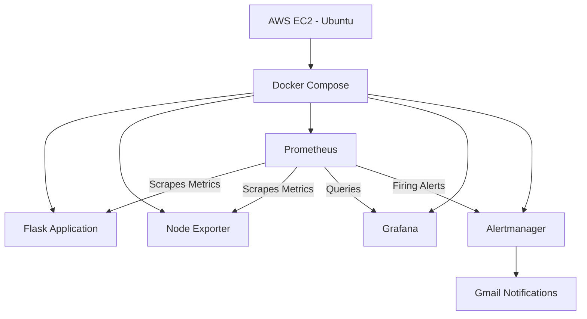

# DevOps Automation & Observability Platform

An end-to-end DevOps monitoring and observability platform built using Docker, Flask, Prometheus, Grafana, Node Exporter, and Alertmanager. Deployed on AWS EC2 with automated email notifications through Gmail.

## Project Overview

This project demonstrates how to monitor a containerized application and its underlying infrastructure using open-source monitoring tools.

It collects application and system metrics, visualizes performance through Grafana dashboards, evaluates infrastructure alert rules using Prometheus, and sends email notifications through Alertmanager.

## Architecture




## Technology Stack

- **Cloud:** AWS EC2
- **Operating System:** Ubuntu Linux
- **Containerization:** Docker, Docker Compose
- **Application:** Python, Flask
- **Monitoring:** Prometheus
- **Visualization:** Grafana
- **Infrastructure Metrics:** Node Exporter
- **Alert Management:** Alertmanager
- **Notifications:** Gmail SMTP
- **Version Control:** Git, GitHub

## Key Features

- Containerized Flask application exposing Prometheus metrics.
- Infrastructure monitoring using Node Exporter.
- Prometheus metrics collection and alert evaluation.
- Grafana integration for monitoring and visualization.
- Alertmanager integration for centralized alert handling.
- Gmail email notifications for infrastructure alerts.
- CPU, memory, and disk usage alert rules.
- Persistent Prometheus and Grafana data volumes.
- Docker-based service deployment and management.

## Configured Alert Rules

| Alert | Threshold | Duration |
|---|---:|---:|
| HighCPUUsage | Above 80% | 2 minutes |
| HighMemoryUsage | Above 80% | 2 minutes |
| HighDiskUsage | Above 85% | 2 minutes |

**Testing status:** CPU alert successfully triggered and Gmail notification received. Memory and disk rules are configured but their threshold-triggering behavior has not yet been tested.

## Project Structure

```text
Devops_platform/
│
├── app/
│   └── Flask application files
│
├── monitoring/
│   ├── prometheus.yml
│   └── rules/
│       └── alerts.yml
│
├── alertmanager/
│   ├── alertmanager.yml
│   └── secrets/
│
├── docker/
├── scripts/
├── docker-compose.yml
├── .gitignore
└── README.md
```

## Deployment

### Prerequisites

- AWS EC2 Ubuntu instance
- Docker Engine
- Docker Compose
- Gmail account with an App Password

### Start the platform

Clone the repository:

```bash
git clone YOUR_GITHUB_REPOSITORY_URL
cd Devops_platform
```

Configure Gmail SMTP credentials and the Alertmanager receiver using your own values. Store the Gmail App Password securely in the secret file expected by the Docker Compose configuration.

Never commit `.env` or secret files to GitHub.

Start all services:

```bash
docker compose up -d
```

Check running containers:

```bash
docker compose ps
```

## Monitoring Endpoints

| Service | Endpoint |
|---|---|
| Flask Metrics | `http://EC2_PUBLIC_IP:5000/metrics` |
| Prometheus | `http://EC2_PUBLIC_IP:9090` |
| Grafana | `http://EC2_PUBLIC_IP:3000` |
| Alertmanager | `http://localhost:9093` |

Restrict access to monitoring ports using AWS Security Groups. Do not expose Alertmanager or internal monitoring services publicly without appropriate security controls.

## Health Verification

```bash
curl http://localhost:5000/metrics
curl http://localhost:9090/-/healthy
curl http://localhost:3000/api/health
curl http://localhost:9093/-/healthy
```

## Learning Outcomes

- Practical experience deploying applications on AWS EC2.
- Container orchestration using Docker Compose.
- Application and infrastructure monitoring.
- Prometheus configuration and alert rule management.
- Grafana monitoring integration.
- Alertmanager and Gmail SMTP notification integration.
- Linux administration and troubleshooting.

## Author

**Dinesh Khade**

DevOps and Cloud Engineer

GitHub: https://github.com/Khade-Dinesh

LinkedIn: https://www.linkedin.com/in/dinesh-khade-9885b4404/

